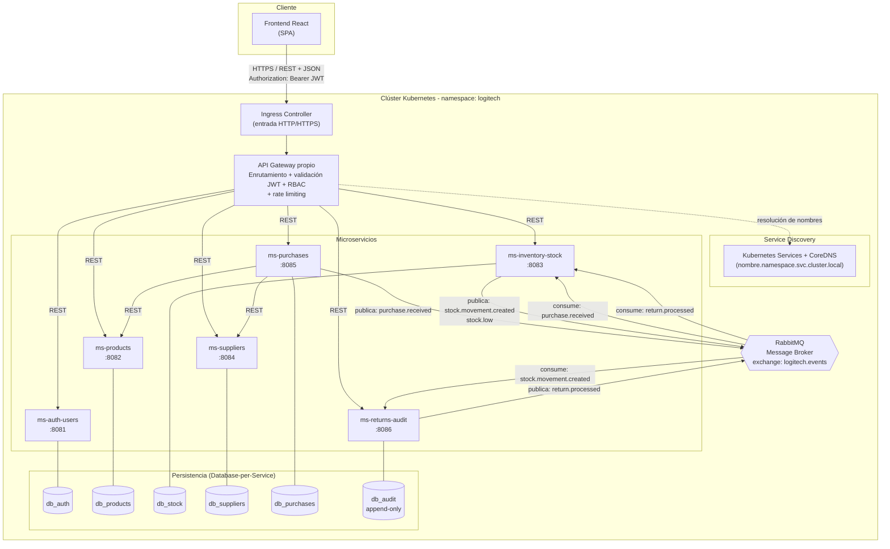
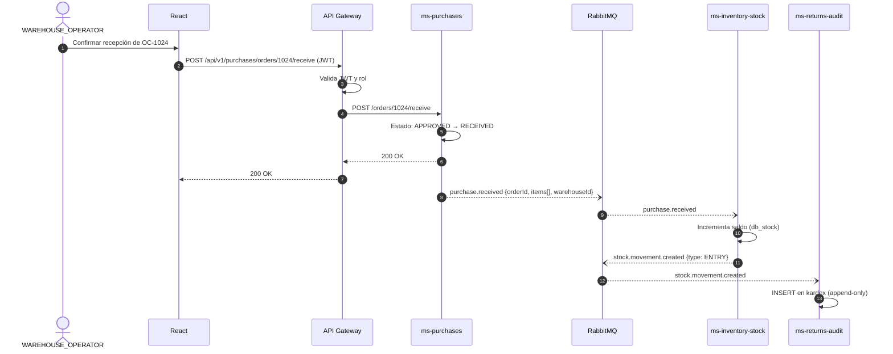
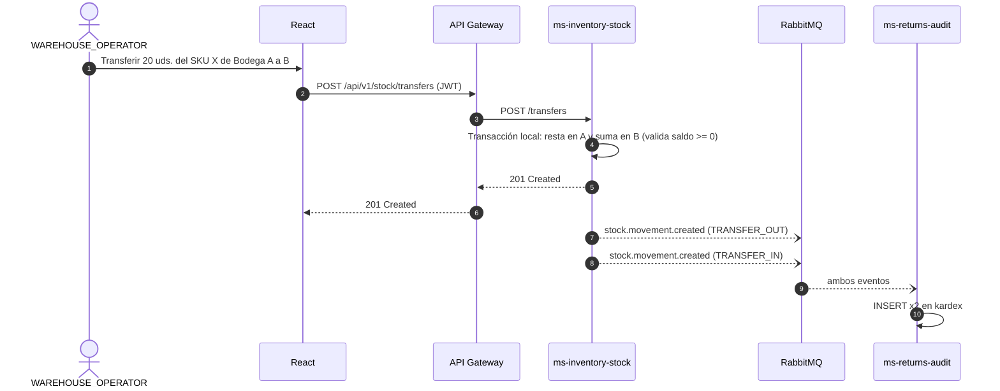
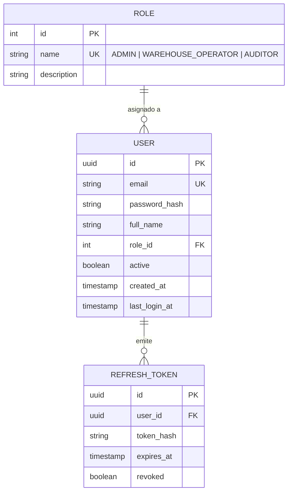
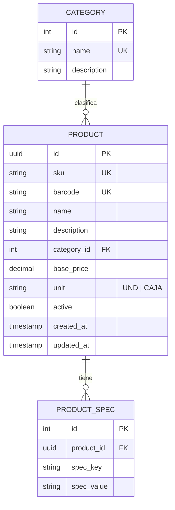
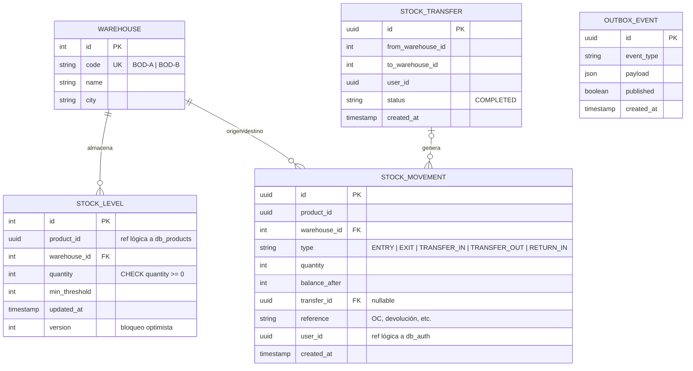
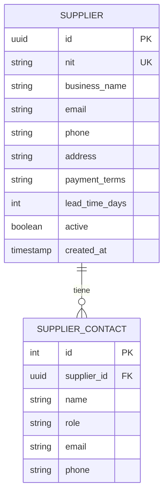
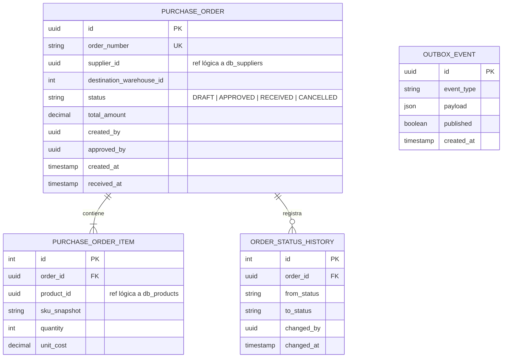
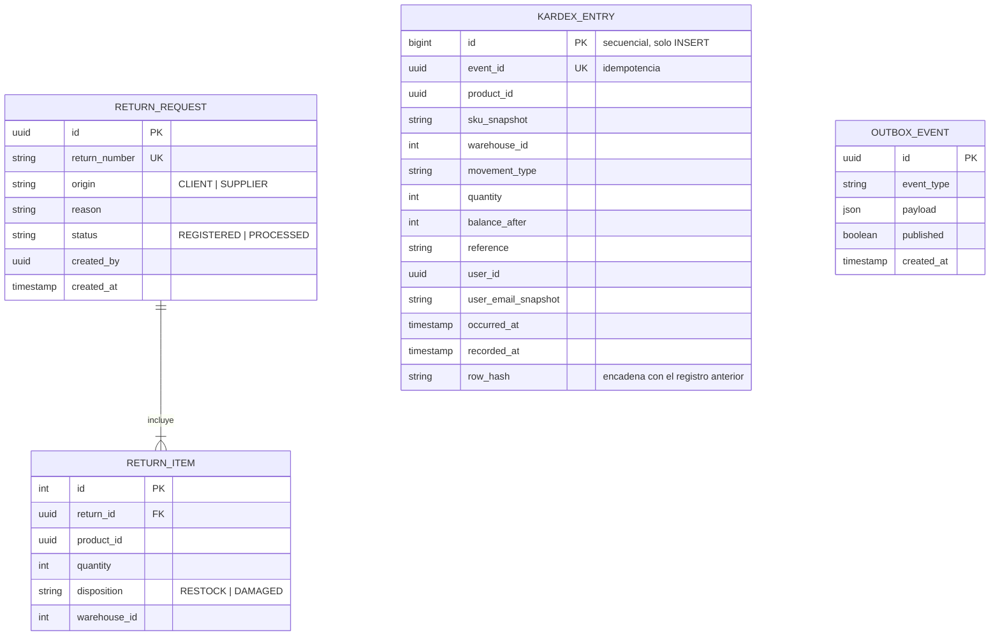

# ENTREGA 2: DISEÑO DE ARQUITECTURA

**Asignatura:** Ingeniería de Software II
**Proyecto:** Sistema de Gestión de Inventarios - LogiTech Solutions S.A.S.
**Equipo / Integrantes:** Mariana Duque Giraldo, Andrés Felipe Gálvez Carmona
**Entrega N.°:** 2

---

## Índice

1. Diagrama de arquitectura de microservicios
2. Diseño de contratos de API por microservicio (OpenAPI/Swagger)
3. Modelo de datos por microservicio (diagramas entidad-relación)
4. Estrategia de contenerización y orquestación (Dockerfiles y manifiestos de Kubernetes)
5. Bitácora de Uso de Inteligencia Artificial (IA)

---

## 1. Diagrama de arquitectura de microservicios

### 1.1 Vista general de componentes y comunicación



**Lectura del diagrama**

| Elemento | Función |
| --- | --- |
| Frontend React | SPA que solo conoce al API Gateway; nunca llama directamente a un microservicio (RF01, RF12, RNF01). |
| Ingress | Punto de entrada al clúster; termina TLS y reenvía al API Gateway. |
| API Gateway propio | Valida el JWT, aplica RBAC por ruta, enruta y limita peticiones (RNF05, RNF07). |
| Service Discovery | Se resuelve con los Service de Kubernetes y CoreDNS: cada microservicio se invoca por nombre (por ejemplo http://ms-inventory-stock:8083) sin IPs fijas. |
| Microservicios | Seis servicios autónomos, cada uno con arquitectura hexagonal (RNF11). |
| Bases de datos | Una por servicio; ningún servicio accede a la base de otro (RNF02). |
| RabbitMQ | Propaga eventos de dominio sin acoplamiento temporal (RNF08). |

### 1.2 Reglas de comunicación

| Tipo | Origen -> Destino | Uso |
| --- | --- | --- |
| Síncrona REST/JSON | React -> API Gateway | Todas las acciones del usuario. |
| Síncrona REST/JSON | API Gateway -> microservicio | Enrutamiento tras validar JWT. |
| Síncrona REST/JSON | ms-purchases -> ms-products / ms-suppliers | Validar existencia de SKU y proveedor al crear una orden (lectura). |
| Asíncrona AMQP | ms-purchases -> RabbitMQ -> ms-inventory-stock | purchase.received incrementa stock (RF10). |
| Asíncrona AMQP | ms-inventory-stock -> RabbitMQ -> ms-returns-audit | stock.movement.created alimenta el Kardex (RF07). |
| Asíncrona AMQP | ms-returns-audit -> RabbitMQ -> ms-inventory-stock | return.processed reingresa stock si la devolución es reutilizable (RF11). |

**Decisión de diseño:** para no violar RNF02, ningún servicio hace joins contra bases ajenas. Los datos de otros dominios se referencian por identificador (product_id, supplier_id, warehouse_id) y, cuando hace falta mostrar un nombre, el Gateway o el frontend componen la respuesta.

### 1.3 Flujo 1: Recepción de una orden de compra (RF10)



### 1.4 Flujo 2: Transferencia entre bodegas (RF05)



La transferencia es una sola transacción local dentro de db_stock, por eso no se necesita una saga distribuida: ambas bodegas viven en el mismo servicio.

### 1.5 Tolerancia a fallas (RNF09)

| Si falla... | Qué sigue funcionando | Qué ocurre con el resto |
| --- | --- | --- |
| ms-returns-audit | Autenticación, catálogo, stock y compras. | Los eventos quedan en la cola de RabbitMQ y se consumen al volver el servicio. |
| ms-suppliers | Stock y autenticación. | Solo se bloquea crear proveedores/órdenes nuevas. |
| ms-purchases | Stock y autenticación. | Las recepciones se retoman al reiniciar. |
| RabbitMQ | El saldo de stock se sigue actualizando (síncrono). | Se usa patrón Outbox en db_stock, db_purchases y db_audit: el evento se guarda en la misma transacción y se reenvía cuando el broker vuelve. |

---

## 2. Diseño de contratos de API por microservicio (OpenAPI/Swagger)

**[Ver Documentación Interactiva de APIs (GitHub Pages)](https://angalvezc.github.io/sistema-gestion-inventarios/)**

Los contratos están en formato OpenAPI 3.0 dentro de la carpeta openapi/. Cada servicio publica su Swagger UI en /docs (RNF13).

| Microservicio | Archivo | Rutas por el Gateway | Requerimientos |
| --- | --- | --- | --- |
| ms-auth-users | openapi/ms-auth-users.yaml | /api/v1/auth/**, /api/v1/users/** | RF01, RNF07 |
| ms-products | openapi/ms-products.yaml | /api/v1/products/** | RF02 |
| ms-inventory-stock | openapi/ms-inventory-stock.yaml | /api/v1/stock/** | RF03-RF06 |
| ms-suppliers | openapi/ms-suppliers.yaml | /api/v1/suppliers/** | RF08 |
| ms-purchases | openapi/ms-purchases.yaml | /api/v1/purchases/** | RF09, RF10 |
| ms-returns-audit | openapi/ms-returns-audit.yaml | /api/v1/audit/** | RF07, RF11, RF12 |

### 2.1 Resumen de endpoints

ms-auth-users

| Método | Ruta | Rol | Descripción |
| --- | --- | --- | --- |
| POST | /api/v1/auth/login | Público | Autentica y devuelve JWT. |
| POST | /api/v1/auth/refresh | Autenticado | Renueva el token. |
| GET | /api/v1/auth/validate | Interno (Gateway) | Valida token y devuelve claims. |
| GET/POST | /api/v1/users | ADMIN | Lista / crea usuarios. |
| PUT/DELETE | /api/v1/users/{id} | ADMIN | Edita / desactiva usuario. |

ms-products

| Método | Ruta | Rol | Descripción |
| --- | --- | --- | --- |
| GET | /api/v1/products | Todos | Lista con filtros (sku, categoryId, q). |
| POST | /api/v1/products | ADMIN | Crea producto (SKU y código de barras únicos). |
| GET | /api/v1/products/{id} | Todos | Detalle. |
| PUT | /api/v1/products/{id} | ADMIN | Actualiza. |
| DELETE | /api/v1/products/{id} | ADMIN | Baja lógica. |
| GET/POST | /api/v1/categories | Todos / ADMIN | Categorías. |

ms-inventory-stock

| Método | Ruta | Rol | Descripción |
| --- | --- | --- | --- |
| GET | /api/v1/stock | Todos | Saldos por producto y bodega. |
| GET | /api/v1/stock/{productId} | Todos | Saldo de un producto en ambas bodegas. |
| POST | /api/v1/stock/movements | ADMIN, WAREHOUSE_OPERATOR | Entrada o salida; rechaza saldo negativo. |
| POST | /api/v1/stock/transfers | ADMIN, WAREHOUSE_OPERATOR | Transferencia Bodega A <-> B. |
| GET | /api/v1/stock/alerts | Todos | Productos bajo el mínimo o agotados. |
| PUT | /api/v1/stock/{productId}/min-threshold | ADMIN | Umbral mínimo por bodega. |
| GET | /api/v1/warehouses | Todos | Las 2 bodegas. |

ms-suppliers

| Método | Ruta | Rol | Descripción |
| --- | --- | --- | --- |
| GET/POST | /api/v1/suppliers | Todos / ADMIN | Directorio. |
| GET/PUT/DELETE | /api/v1/suppliers/{id} | Todos / ADMIN | Detalle, edición, baja. |

ms-purchases

| Método | Ruta | Rol | Descripción |
| --- | --- | --- | --- |
| GET/POST | /api/v1/purchases/orders | Todos / ADMIN | Lista / crea (estado DRAFT). |
| GET | /api/v1/purchases/orders/{id} | Todos | Detalle con ítems. |
| POST | /api/v1/purchases/orders/{id}/approve | ADMIN | DRAFT -> APPROVED. |
| POST | /api/v1/purchases/orders/{id}/receive | ADMIN, WAREHOUSE_OPERATOR | APPROVED -> RECEIVED y publica evento. |
| POST | /api/v1/purchases/orders/{id}/cancel | ADMIN | Cancela si no fue recibida. |

ms-returns-audit

| Método | Ruta | Rol | Descripción |
| --- | --- | --- | --- |
| GET | /api/v1/audit/kardex | AUDITOR, ADMIN | Consulta con filtros (producto, bodega, fechas, tipo, usuario). |
| GET | /api/v1/audit/kardex/{id} | AUDITOR, ADMIN | Un registro. |
| POST | /api/v1/audit/returns | ADMIN, WAREHOUSE_OPERATOR | Registra devolución/garantía (reingreso o avería). |
| GET | /api/v1/audit/returns | Todos | Lista de devoluciones. |
| GET | /api/v1/audit/dashboard/metrics | Todos | Valor del inventario, agotados, movimientos del día (RF12). |

### 2.2 Convenciones comunes

- Seguridad: esquema bearerAuth (JWT) en todo menos /auth/login.
- Errores: formato único { "code", "message", "details", "timestamp", "path" }.
- Paginación: ?page=0&size=20; respuesta con content, page, size, totalElements.
- Códigos HTTP: 200, 201, 204, 400, 401, 403, 404, 409 (conflicto: SKU duplicado, saldo insuficiente), 422, 500.
- Versionado: prefijo /api/v1 en el Gateway.

---

## 3. Modelo de datos por microservicio (diagramas entidad-relación)

Las referencias entre servicios (product_id, supplier_id, etc.) son identificadores lógicos sin llave foránea, porque las tablas viven en bases distintas.

### 3.1 db_auth (ms-auth-users)



### 3.2 db_products (ms-products)



### 3.3 db_stock (ms-inventory-stock)



OUTBOX_EVENT no se relaciona con otras tablas: guarda los eventos pendientes de enviar a RabbitMQ.

### 3.4 db_suppliers (ms-suppliers)



### 3.5 db_purchases (ms-purchases)



### 3.6 db_audit (ms-returns-audit)



**Inalterabilidad del Kardex (RNF12):**

```sql
-- Usuario de la aplicación sin permisos de modificación
REVOKE UPDATE, DELETE, TRUNCATE ON kardex_entry FROM app_audit;
GRANT  SELECT, INSERT ON kardex_entry TO app_audit;

-- Defensa adicional: trigger que bloquea cualquier cambio
CREATE FUNCTION kardex_block_changes() RETURNS trigger AS $$
BEGIN
  RAISE EXCEPTION 'kardex_entry es append-only';
END; $$ LANGUAGE plpgsql;

CREATE TRIGGER trg_kardex_no_update_delete
BEFORE UPDATE OR DELETE ON kardex_entry
FOR EACH ROW EXECUTE FUNCTION kardex_block_changes();
```

El campo event_id único evita registros duplicados si RabbitMQ reentrega un mensaje (consumo idempotente).

---

## 4. Estrategia de contenerización y orquestación

### 4.1 Contenerización con Docker

| Decisión | Detalle |
| --- | --- |
| Imágenes | Una por componente: logitech/frontend, logitech/api-gateway y una por microservicio. |
| Dockerfile | Multi-stage (compilar y luego copiar solo el resultado) para imágenes pequeñas. |
| Seguridad | Usuario no root, sin secretos dentro de la imagen. |
| Salud | Cada servicio expone /health/live y /health/ready. |
| Configuración | Variables de entorno (12-factor); en Kubernetes vía ConfigMap y Secret. |
| Bases y broker | Imágenes oficiales (postgres:16-alpine, rabbitmq:3-management). |

Archivos entregados:

```text
docker/
├── Dockerfile.microservice     # plantilla compartida por los 6 servicios y el gateway
├── Dockerfile.frontend         # build de React corriendo sobre Node.js
└── docker-compose.yml          # entorno local completo (RNF14)
```

### 4.2 Orquestación con Kubernetes

| Recurso | Uso |
| --- | --- |
| Namespace | logitech aísla todo el sistema. |
| Deployment | Uno por microservicio, gateway y frontend. Mínimo 2 réplicas en servicios críticos (RNF04). |
| StatefulSet | Bases de datos y RabbitMQ, con PersistentVolumeClaim. |
| Service (ClusterIP) | Descubrimiento de servicios por nombre. |
| Ingress | Entrada externa hacia el frontend y el gateway. |
| ConfigMap / Secret | Configuración y credenciales (JWT, contraseñas de BD). |
| HorizontalPodAutoscaler | Escala por CPU/memoria (RNF10). Más agresivo en ms-inventory-stock. |
| readinessProbe / livenessProbe | Solo recibe tráfico un pod listo; se reinicia el que no responde. |
| NetworkPolicy | Cada base de datos acepta tráfico únicamente de su microservicio (refuerza RNF02). |

Archivos entregados en k8s/:

```
k8s/
├── 00-namespace-config.yaml    # namespace, ConfigMap y Secret
├── 10-data-layer.yaml          # StatefulSets de las 6 BD y RabbitMQ + Services
├── 20-ms-inventory-stock.yaml  # Deployment + Service + HPA (patrón repetible)
├── 30-gateway-frontend.yaml    # Gateway, frontend e Ingress
└── 40-network-policies.yaml    # aislamiento de bases de datos
```

El manifiesto 20-ms-inventory-stock.yaml sirve de plantilla para los otros cinco servicios: solo cambian nombre, puerto e imagen.

### 4.3 Orden de despliegue

```bash
# Local
docker compose -f docker/docker-compose.yml up --build

# Kubernetes (por ejemplo con minikube o kind)
kubectl apply -f k8s/00-namespace-config.yaml
kubectl apply -f k8s/10-data-layer.yaml
kubectl apply -f k8s/20-ms-inventory-stock.yaml
kubectl apply -f k8s/30-gateway-frontend.yaml
kubectl apply -f k8s/40-network-policies.yaml
kubectl -n logitech get pods
```

---

## 5. Bitácora de Uso de Inteligencia Artificial (IA)

| Proyecto | Sistema de Gestión de Inventarios - LogiTech Solutions S.A.S. |
| --- | --- |
| Equipo / Integrantes | Mariana Duque Giraldo, Andrés Felipe Gálvez Carmona |
| Entrega N.° | 2 |
| Periodo cubierto | 16/10/2026 - 26/10/2026 |

| Fecha | Integrante | Herramienta de IA | Tarea / Actividad Apoyada | Prompt Utilizado (Resumen) | Nivel de Intervención Humana | Resultado / Aprendizaje |
| --- | --- | --- | --- | --- | --- | --- |
| 17/10/2026 | Andrés Felipe Gálvez Carmona | Gemini / Claude | Generación del esqueleto Mermaid para la arquitectura de microservicios e Ingress. | Genera un diagrama Mermaid flowchart TB que muestre el cliente React, Ingress, API Gateway, 6 microservicios con sus BD aisladas y RabbitMQ. | Alto | Se obtuvo la estructura inicial en Mermaid y se corrigió manualmente el enrutamiento de Service Discovery con CoreDNS y los nombres de los endpoints. |
| 17/10/2026 | Andrés Felipe Gálvez Carmona | Gemini| Estructuración de especificaciones OpenAPI 3.0 para ms-auth-users y ms-products. | Crea el esquema OpenAPI 3.0 en YAML para los endpoints de login, validación de JWT y CRUD de productos con respuestas 200, 400 y 409. | Medio | Se validó la sintaxis en Swagger Editor y se agregaron los campos específicos del caso de estudio de LogiTech (SKU, código de barras). |
| 18/10/2026 | Mariana Duque Giraldo | Claude | Generación de diagramas de secuencia Mermaid para flujos transaccionales (Recepción de OC y Transferencias). | Diseña dos diagramas de secuencia en Mermaid para ilustrar: 1) la recepción de órdenes de compra con publicación de eventos en RabbitMQ y 2) la transferencia de stock entre Bodega A y B. | Medio | Se generaron los flujos visuales en Mermaid (secciones 1.3 y 1.4) para representar la comunicación síncrona/asíncrona entre el Gateway, microservicios, broker y base de datos. |
| 19/10/2026 | Mariana Duque Giraldo| Claude | Estructuración de diagramas Entidad-Relación en Mermaid para la persistencia independiente (Database-per-Service). | Diseña los diagramas ERD en syntax Mermaid erDiagram para las 6 bases de datos independientes (db_auth, db_products, db_stock, db_suppliers, db_purchases, db_audit) usando referencias lógicas sin llaves foráneas físicas entre servicios. | Alto | Se obtuvieron los modelos de datos de la Sección 3, asegurando la aplicación estricta del patrón Database-per-Service (RNF02), el patrón Outbox para RabbitMQ y el esquema inmutable Append-Only del Kardex (RNF12). |
| 20/10/2026 | Mariana Duque Giraldo | Claude | Diseño de triggers de base de datos PostgreSQL para garantizar la inalterabilidad Append-Only del Kardex. | Escribe un script SQL en PostgreSQL con triggers que impidan UPDATE y DELETE en la tabla kardex_entry para cumplir con un RNF de auditoría inmutable. | Alto | Se implementó el trigger en db_audit y la función plpgsql, añadiendo además la restricción REVOKE a nivel de permisos de usuario de BD. |
| 20/10/2026 | Andrés Felipe Gálvez Carmona | Gemini | Auditoría final de la Entrega 2 | Revisa si la entrega 2 cumple con todo lo que exige el PDF del proyecto. | Alto | Se validó el cumplimiento del 100% de la rúbrica. Se tomó la decisión crítica de eliminar "Nginx" del Dockerfile por exceder el alcance académico, optando por Node.js. Se apropiaron los conceptos de manifiestos YAML para una defensa técnica sólida. |
| 23/10/2026 | Mariana Duque Giraldo | Claude | Formateo y unificación del documento de arquitectura en sintaxis Markdown (.md). | Dame el doc .md completo y unificado con toda la estructura solicitada y tablas limpias para copiar y pegar. | Bajo | Se logró consolidar toda la investigación, diagramas Mermaid, tablas OpenAPI y modelos ERD en un único archivo estándar, respetando la jerarquía visual lista para alojar en GitHub. |
| 24/10/2026 | Mariana Duque Giraldo | Claude | Guía paso a paso para la estructuración y creación de especificaciones OpenAPI/Swagger. | ¿Cuáles son los pasos completos para estructurar la documentación OpenAPI de los 6 microservicios y publicarlos en GitHub Pages? | Alto | Se estableció la hoja de ruta técnica para organizar los contratos .yaml en la carpeta openapi/ y configurar el punto de entrada en docs/index.html. |
| 24/10/2026 | Mariana Duque Giraldo | Claude | Solución de errores de pantalla en blanco y carga en GitHub Pages. | La página en GitHub Pages no carga la documentación y sale un error en la consola sobre import.meta | Medio | Se fijó la versión estable de la librería (2.1.2) en index.htm` y se desbloqueó el despliegue del sitio web en GitHub Pages.[cite: 1] |
| 24/10/2026 | Andrés Felipe Gálvez Carmona | Gemini | Implementación del menú selector para navegar entre los 6 microservicios. | ¿Cómo hago para que en la página de GitHub Pages se puedan ver todos los microservicios en un solo lugar con un menú desplegable? | Alto | Se estructuró una barra superior con un menú selector <select> que permite alternar la vista entre todos los archivos YAML del sistema.[cite: 1] |
| 24/10/2026 | Andrés Felipe Gálvez Carmona | Gemini | Adaptación del visor visual a la interfaz estándar de bloques horizontales (Swagger UI). | Necesito que la documentación visual de mis microservicios se despliegue en el formato estándar de bloques horizontales| Medio | Se adaptó la plantilla de index.html para usar Swagger UI en lugar de Redoc, manteniendo la navegación interactiva del menú desplegable. |
| 24/10/2026 | Andrés Felipe Gálvez Carmona | Gemini | Resolución de bloqueos de sincronización y despliegue en Git/GitHub. | Me sale un error de git push rechazado y la página no actualiza los cambios | Medio | Se identificaron los cambios locales atascados en Git y se forzó la actualización del servidor remoto mediante`git push origin HEAD:main --force. |
| 24/10/2026 | Andrés Felipe Gálvez Carmona | Gemini | Completitud de los contratos OpenAPI con operaciones CRUD de edición y borrado. | En los esquemas faltaban las opciones de editar o eliminar usuarios, productos y proveedores. Dame los bloques completos en YAML para agregarlos. | Alto | Se incluyeron los endpoints PUT y DELETE para entidades maestras en los archivos .yaml, logrando una coherencia del 100% entre el Swagger y el modelo de datos. |


